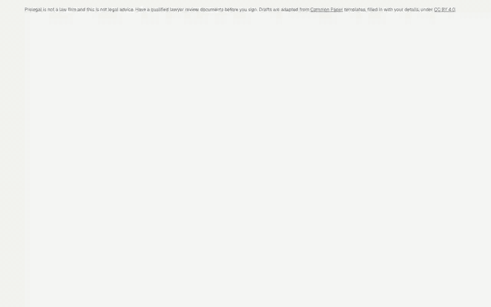
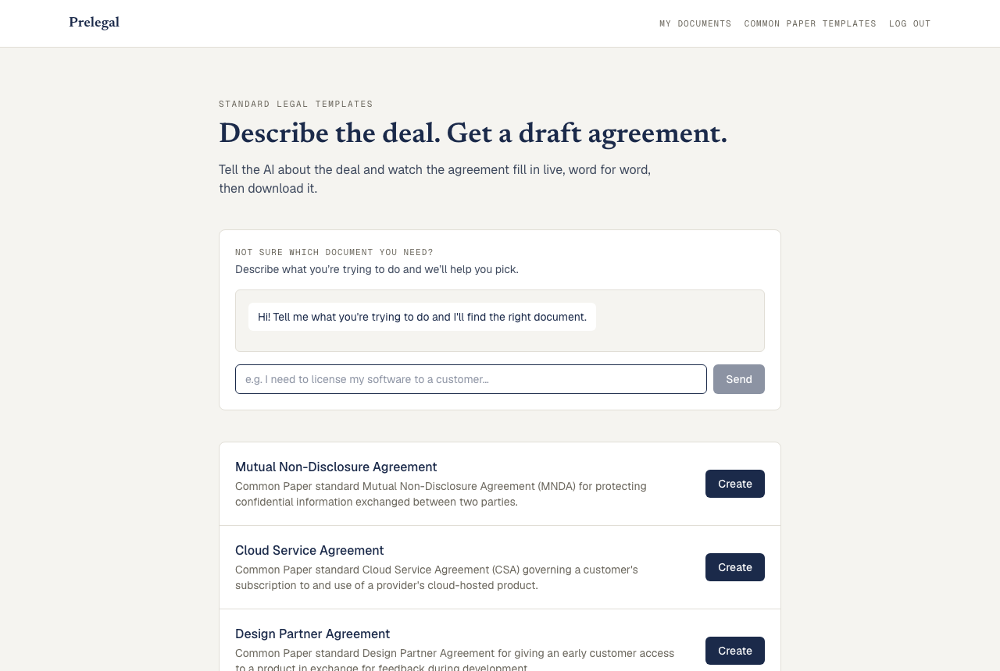
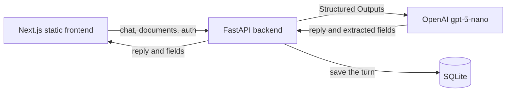

# Prelegal

Draft legal agreements by chatting with AI. Describe the deal in plain English and watch the document fill in live, then download it as a PDF.



[Watch the full-quality demo video](assets/demo.mp4)

## Features

- **11 agreement types** based on [Common Paper](https://commonpaper.com) standard templates, including NDAs, cloud service agreements and data processing agreements
- **Live preview** that updates as the AI extracts details from the conversation
- **Document matching** that finds the right agreement from a plain-English description
- **PDF export** handled in the browser
- **Accounts and document history** so you can resume or delete past drafts



## Run it yourself

You need [Docker](https://www.docker.com/products/docker-desktop/) and your own [OpenAI API key](https://platform.openai.com/api-keys). Using the app costs a small amount on your OpenAI account, about $0.001 per AI message when tested.

1. Copy the example settings file:

   ```bash
   cp .env.example .env
   ```

2. Open `.env` and replace `your-key` with your OpenAI API key.

3. Start the app:

   ```bash
   docker compose up --build -d --wait
   ```

4. Open http://localhost:8000 and create an account.

To stop it, run `docker compose down`. If it doesn't start, `docker compose logs app` shows why.

All data, including accounts and documents, is erased whenever the app restarts.

## How it works



One Docker container holds everything: FastAPI serves both the API and the statically exported Next.js frontend.

**Key decisions**

- **One metadata table drives every document.** `backend/app/core/documents.py` lists each document's fields, and the validation schema and AI prompt are generated from it at request time. Adding a document type doesn't need new model code.
- **Structured Outputs instead of parsing text.** The AI's reply always matches a schema, so extracted fields can go straight into the document.
- **Bounded AI costs per request.** Only the latest 40 messages reach OpenAI, message sizes and output tokens are capped, and calls have a timeout with no automatic retries.
- **Untrusted text stays inert.** User and AI text is filled into the template in a way that can't become a link or script in the preview, which is covered by tests.

## Tech stack

| Area | Tools |
|---|---|
| Frontend | Next.js, React, TypeScript, Tailwind CSS |
| Backend | Python, FastAPI, SQLModel, SQLite |
| AI | OpenAI API with Structured Outputs |
| Auth | bcrypt, httpOnly session cookies |
| Testing | pytest, Vitest, Playwright |
| Delivery | Docker Compose, GitHub Actions |

## Development

```bash
# Backend tests
cd backend
uv run pytest

# Frontend unit tests, lint and browser tests
cd frontend
npm test
npm run lint
npm run test:e2e
```

Every pull request runs these checks plus a Docker build.

## Licence and disclaimer

The code is under the [MIT License](LICENSE). The agreement templates are adapted from [Common Paper](https://github.com/CommonPaper) under [CC BY 4.0](https://creativecommons.org/licenses/by/4.0/): the app fills in their placeholders and formats them for the preview and PDF. See [templates/LICENSE.txt](templates/LICENSE.txt).

Prelegal is not a law firm and nothing it produces is legal advice. Documents are drafts, so have a qualified lawyer review them before you sign.
